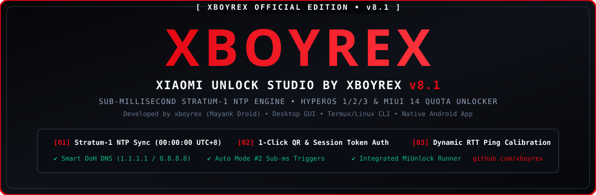

<div align="center">



<br/><br/>

# XBOYREX Unlock Studio v8.1 (MiUnlockTool by xboyrex)

**High-Precision Sub-Millisecond Stratum-1 NTP Bootloader Quota & Fastboot Unlocking Suite for Xiaomi HyperOS 1 / 2 / 3 & MIUI 14**  
*Developed by **xboyrex (Mayank Droid)** — Desktop GUI • Standalone Termux/Linux CLI • Native Android App*

[](https://github.com/xboyrex/miunlocktool/releases)
[](https://github.com/xboyrex)
[](https://xboyrex.github.io/mayank-droid/)
[](https://t.me/MayankDroid7)
[](https://youtube.com/@mayankdroid)

</div>

---

## 1. Quick Installation — Android (Termux) One-Liner

Run directly on your Android phone via **Termux** (no PC required):

```sh
curl -sS https://raw.githubusercontent.com/xboyrex/miunlocktool/main/install.sh | bash
```

Launch the **XBOYREX Edition** CLI:

```sh
miunlocktool
```

---

## 2. Desktop GUI & CLI Setup (Windows / Linux / macOS)

### Run the Obsidian & Crimson Desktop GUI (`sourcecode/pc/8.1.py`)

```bash
pip install customtkinter packaging ntplib darkdetect pytz urllib3 icmplib requests
python sourcecode/pc/8.1.py
```

### Build Standalone Windows `.exe` (with Custom XBOYREX Icon)

Double-click or run in CMD:

```cmd
cd sourcecode\pc
build_exe.bat
```

### Run Standalone Terminal CLI (`sourcecode/cli/miunlock_cli.py`)

```bash
pip install requests rich miunlock
python sourcecode/cli/miunlock_cli.py
```

---

## 3. Build Native Android `.apk` from Command Line (`sourcecode/android/`)

We include one-click APK build scripts for both **Windows CMD (`build_apk.bat`)** and **Linux / macOS (`build_apk.sh`)**:

### Windows CMD:
```cmd
cd sourcecode\android
build_apk.bat
```

### Linux / macOS:
```bash
cd sourcecode/android
./build_apk.sh
```
The compiled APK is automatically copied to `sourcecode/android/XBOYREX_Unlock_Studio_v8.1.apk`.

---

## 4. Core Architecture & Features

- **Sub-Millisecond Stratum-1 NTP Engine**: Synchronizes against global atomic NTP servers (`time1..4.google.com`, `time.cloudflare.com`, `time.aws.com`) and measures dynamic RTT latency to `sgp-api.buy.mi.com` right before `23:59:59.xxx` Beijing Time (`UTC+8`).
- **Smart DoH DNS Shield**: Built-in DNS-over-HTTPS resolver (`Cloudflare 1.1.1.1` & `Google 8.8.8.8`) prevents ISP DNS blocks during midnight quota windows.
- **3 Authentication Modes (GUI & CLI)**:
  1. **1-Click QR / Browser Login**: Instant token capture from `account.xiaomi.com`.
  2. **1-Click Saved Session Extractor**: Automatically extracts `new_bbs_serviceToken` from `~/.migatesession`.
  3. **Manual Token Input**: Direct `new_bbs_serviceToken` paste.
- **Integrated Fastboot Unlocker (`miunlock`)**: Launch the Fastboot token & `encryptData` unlocker directly from Tab `[03]`.

---

## 5. Official Links & Community

- **Developer**: [xboyrex (Mayank Droid)](https://github.com/xboyrex)
- **Official Website**: [https://xboyrex.github.io/mayank-droid/](https://xboyrex.github.io/mayank-droid/)
- **Telegram Channel**: [https://t.me/MayankDroid7](https://t.me/MayankDroid7)
- **YouTube Primary**: [https://youtube.com/@mayankdroid](https://youtube.com/@mayankdroid)
- **YouTube Secondary**: [https://youtube.com/@onyxdroid89](https://youtube.com/@onyxdroid89)
